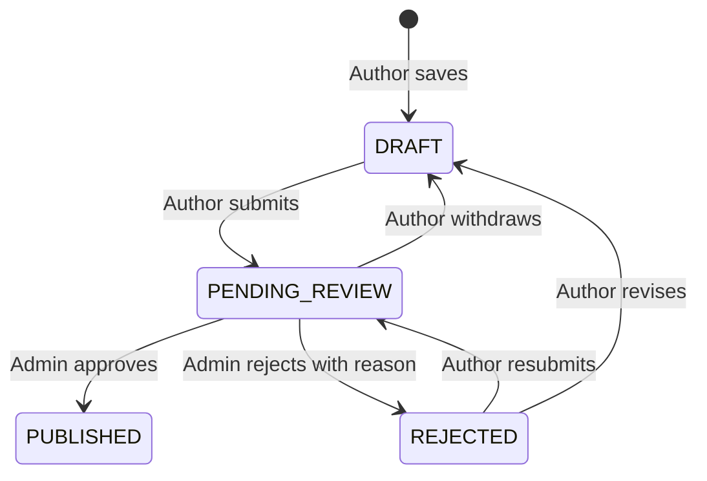

# Blog Community Workflow

## Screens

- `/blog`: published community posts, category filters, search and pagination.
- `/blog/write`: author editor with cover selection, draft saving and preview.
- `/blog/my-posts`: the authenticated author's posts and status filters.
- `/blog/my-posts/{id}`: the author's draft, moderation result, rejection reason and available actions.
- `/blog/my-posts/{id}/edit`: edit a draft or rejected post.
- `/admin/blog`: admin queue, published posts and rejected posts.
- `/admin/blog/{id}`: review full content, approve or reject with a required reason.
- `/blog/{id}`: public article, available only after approval.

## States

Drafts require a title and category. Submission additionally requires a title of at least 5 characters and content of at least 80 characters. Plain text is rendered with React escaping, not executable HTML. Covers support HTTP/HTTPS image URLs and the application's `/images/` assets. There is no image upload/storage API in this release.

Only the author can edit or remove their drafts/rejected posts. Pending posts must first be withdrawn to edit. Published posts are read-only in this release. User-supplied author/status fields cannot publish a post or change its owner. The public API never exposes drafts, pending/rejected posts or private reviewer notes. Private access and mutations check the account's current database status; admin queue/detail/review also check the current database role, so locking an account or demoting an admin revokes Blog privileges even for an old token.

Every mutation requires the current server `version`; row locks and version checks prevent stale saves, duplicate decisions and approval of withdrawn/resubmitted revisions. A conflict returns HTTP 409 and requires a reload. The pending author status page checks for updates every 15 seconds while visible. Moderation notifications are in-app statuses; no email or AI approval score is implemented.

## API

| Purpose | Endpoint |
| --- | --- |
| Published list / detail | `GET /api/blog/posts`, `GET /api/blog/posts/{id}` |
| Author list / detail | `GET /api/blog/my-posts`, `GET /api/blog/my-posts/{id}` |
| Save draft / edit | `POST /api/blog/my-posts`, `PUT /api/blog/my-posts/{id}` |
| Submit / withdraw | `POST /api/blog/my-posts/{id}/submit`, `POST /api/blog/my-posts/{id}/withdraw` |
| Delete editable post | `DELETE /api/blog/my-posts/{id}?version={version}` |
| Admin queue / detail | `GET /api/admin/blog/posts`, `GET /api/admin/blog/posts/{id}` |
| Review | `POST /api/admin/blog/posts/{id}/review` |

Review payload: `{ "version": 3, "decision": "REJECT", "reason": "Please revise..." }`. Approvals use `APPROVE`; rejections require a nonblank reason. The backend derives reviewer and author identity from the authenticated session.

Backend persistence uses a new `blog_posts` table under the existing Hibernate `ddl-auto=update` setup. Restart the updated backend to register its new entities/controllers; existing content is not reset. Previous static demo articles are no longer presented as community submissions or fabricated admin approvals.

## Verification

Frontend: `npm test` and `npm run build`.

Backend: `mvn -Dtest=BlogControllerTest test` with JDK 21. Tests use H2 and test JWT users with transaction rollback. Browser workflow checks use isolated fixtures for authenticated writes; no real account credentials or production moderation actions are used.
